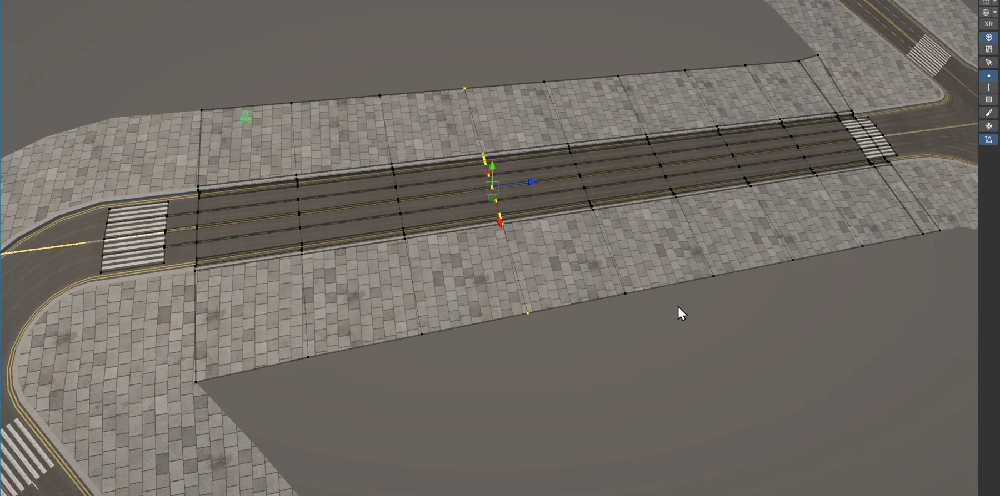

# Creating Roads

## :lucide-pen-line: Drawing a road

1. In the **Roads** panel, click **Edit Road Points**.
2. Click :wtk-new-splines: **Create Splines** on the [Splines Edit toolbar](../splines/index.md#splines-edit-toolbar).
3. **Click** in the Scene view to start a new road, then **click** to add more points.
4. Press ++esc++ or ++enter++, or **right-click**, to finish. A road needs at least two points.

Creation stays on for the next road. Press ++esc++ again, when you aren't drawing, to turn creation off, and once more to stop editing road points. Clicking **Create Splines** while the Roads module is open also starts editing road points, so step 1 can be skipped.

New roads use the **Road Rules** set under **New Roads** in the Roads panel: they copy its setup and keep a reference to it, along with the [Lane Overrides](#lane-overrides-for-new-roads) set there. See [Road Rules](#road-rules).

In the Hierarchy, a new road goes right after the last road you created, under the same parent. Move a road into a group and the next ones go there too. [Junctions](junctions.md#creating-junctions) follow their own last one the same way.

To continue an existing road, **double-click** one of its end knots, then click to add points.

!!! tip "Straight segments and rounded corners"
    The :wtk-new-splines: **New Splines** panel in the Scene view sets how new knots are made. With **New Spline Mode** set to **Linear**, roads are drawn as straight segments, and [Auto Round Mode](#rounded-corners) can round their corners for you.

### Connecting while drawing

- Click on the **middle of another road** (its spline) to create a [junction](junctions.md) there.
- Click on an **existing junction**, anywhere on it, to connect the new road to it. The junction's outline shows while it is the target. Keep clicking past it to run the road through the junction.
- Start or end the new road on the **outer edge** of another road, or on the side of a junction, to attach it there. On a road's edge a dialog asks, when you finish the road, whether to make an [anchored connection](anchored-connections.md) or an [access connection](access-connections.md); a junction's side makes an anchored connection.

A click on a road, on its edge or on a junction's surface only connects the new road while the Scene view looks down on the roads by at least 45°, so a click near the horizon doesn't join a far road. A junction's handle joins it from any view.

The junctions and connections are made when you finish the road.

## :lucide-mouse-pointer-click: Editing a road

With **Edit Road Points** active:

- **Click** spline knots to select them, and **drag** selected knots or their handles to reshape the road.
- **Double-click** a road's spline to insert a knot there.
- **Drag a knot** onto another road to create a junction there, or onto a junction to connect it to that junction.
- **Drag a road end** onto the outer edge of another road to attach it with an [anchored connection](anchored-connections.md) or an [access connection](access-connections.md), as a dialog asks, or onto a row of lane tips of another road (shown while you drag) to continue those lanes with a lane access.

A new junction on a road and a new anchored or access connection are only offered while the Scene view looks down on the roads by at least 45°, so a knot dragged past a road near the horizon doesn't join it. Dropping a knot on an existing junction works from any view.

A knot inserted on a curved span, by double-clicking it or by connecting another road there, keeps the road's shape: it gets **Continuous** handles, and the handles of the knots on either side shorten to fit their part of the span, so a **Mirrored** knot between two spans becomes **Continuous**.

Knots work the same as on any [spline](../splines/spline-container.md#editing-knots), including the right-click menu.

Select a road to show its lane controls in the Scene view, where you can change lane directions and add or remove lanes. They cross the road under the middle of the view (where the view's centre meets the ground) and glide along it as the camera moves. See [Lanes](profiles-and-layers.md#lanes). To hide them, turn off **Show Lane Controls** under **Points** in the Roads panel.

With **Show Spline Range Controls** on, the selected roads also show the spline ranges of their groups, layers, sub layers and lanes, to move, add and remove in the Scene view. See [Editing spline ranges in the Scene view](profiles-and-layers.md#editing-spline-ranges-in-the-scene-view).

### Layer widths in the Scene view

Turn on **Show Width Controls** under **Points** in the Roads panel to show a width handle on each layer of the selected roads, across the road where its lane controls are: under the middle of the view, gliding along the road as the camera moves. A green line spans each layer, and the handle, a small cube, sits on an edge its width moves: the outer edge (the left one for layers left of the road's middle, the right one otherwise) in a centred group, where the lanes stay centred and the layers beside them grow outwards, or the edge away from the group's **Anchor Group Id** in a group placed against another. Each group's handles sit one step further along the road than the previous group's, its layers side by side.

- **Drag** a handle sideways to change the layer's **Width Multiplier**. The handles stay where they are along the road until you release the mouse. **Esc** while dragging puts it back.
- **Click** a handle to select it: it and its layer's line turn white and the other lines fade, and the **Layer Width** overlay (bottom right of the Scene view by default) shows its **Road**, **Group** and **Layer** and, on a road with rules, whether the width comes from the road's override or the rules (**Width From**); then the layer's width on this road in metres (**Width (m)**, its lanes included) and its **Width Multiplier**, to type a value. **Frame Selected** (++f++) frames the handle; **Esc** deselects it.
- **Shift+click** handles to select several, or to take one out of the selection. The overlay shows the last one clicked: what the selected layers don't share shows as a dash (**—**), and a width or multiplier typed in applies to every selected layer, in one undo step. **Drag** one of the selected handles to widen or narrow all their layers by as many metres; a click on one of them without dragging selects it alone.
- **Right-click** a handle and choose **Remove Override** to make the layer follow the rules' width multiplier again (roads with rules).
- Hover a handle to see the layer's name, width and multiplier, and whether the change goes to the road's override or to the rules.

Width handles are for the top-level layers; sub layers keep the widths set in their layer.

!!! note "Roads that follow Road Rules"
    On a road that references [Road Rules](#road-rules), a width handle changes the layer's [Layer Overrides](#road-settings) on this road only. When the layer's **Override Width Multiplier** is off, the first change asks whether to override it on this road: **Override** turns it on, starting from the rules' value, and **Cancel** leaves the width as it is. The rules asset is never changed from the Scene view.

## :wtk-component-spline-container: Converting existing splines

Select one or more spline containers and click :wtk-component-editable-mesh-road: **Create from Selection** under **New Roads** in the Roads panel. Splines become roads that use the **New Roads** rules and lane overrides, and [linked knots](../splines/link-groups.md) become junctions.

## :wtk-component-editable-mesh-road: Road settings

**Road Name**
:   The name written along the road in the Scene view, when **Road Names** in the [Roads settings](settings.md#general) shows them. Leave it empty to show the GameObject name. Changing it doesn't rebuild the road.

**Spline Container**
:   The spline the road follows.

**Rules**
:   Optional [Road Rules](#road-rules). While it's set, the road is generated from the asset's layers and generation settings, and the road's own copies of those settings are hidden. Expand the field's arrow to edit the asset from the road inspector, or click **New** to create a Road Rules asset and assign it.

**Lane Overrides**
:   Appears when the road has lane layers, with one entry per lane layer (**Lane 0**, **Lane 1** and so on, followed by the layer's name). It changes that lane on this road only, without touching the rules:

    - Turn on **Override Extra Lanes** to give this road its own **Extra Lanes** count (roads with rules).
    - Turn on **Override Directions** to give it its own **Lane Direction**, and choose which extra lanes run the other way with **Invert Extra Lane 1**, **Invert Extra Lane 2** and so on (roads with rules).
    - Turn on **Lane 1 Spline Ranges**, **Lane 2 Spline Ranges** and so on to build each lane of the layer only along its **Spline Ranges**; outside them its place stays empty. These work on roads with or without rules. See [Lanes](profiles-and-layers.md#lanes).

    An override starts from the rules' values. While it's off, its fields are greyed out and show the rules' values.

**Layer Overrides**
:   Appears below **Lane Overrides** when the road's **Rules** have layers, with one entry per layer of the rules' groups. It changes that layer on this road only: the road's mesh, its junctions and its width follow it, and the rules asset isn't changed.

    - Turn on **Override Width Multiplier** to give the layer its own **Width Multiplier**. Sublayers keep their own widths.
    - Turn on **Override Spline Ranges** to give the layer its own **Spline Ranges** (as many as you need; an empty list uses the whole road). Each of the layer's sub layers, listed under it, has its own **Override Spline Ranges** too.

    An override starts from the rules' values. While it's off, its fields are greyed out and show the rules' values. The Scene view's [width](#layer-widths-in-the-scene-view) and [spline range](profiles-and-layers.md#editing-spline-ranges-in-the-scene-view) handles change these overrides.

**Group Overrides**
:   Appears below **Layer Overrides**, with one entry per group of the rules. Turn on **Override Spline Ranges** to give the group its own **Spline Ranges** on this road only, starting from the rules' ranges.

**Road Layer Groups**
:   The road's own layers. See [Profiles and Layers](profiles-and-layers.md). When none of the layers has a profile, the road uses its **Default Mesh**, which then shows up in the inspector; see [Default mesh](profiles-and-layers.md#default-mesh).

**Lock Materials**
:   Keeps the current material slots when the road rebuilds, instead of resetting them from the profiles.

**Allow Roll**
:   Lets the road bank (tilt sideways) following each knot's rotation, for banked curves.

<figure class="wtk-video">
  <video controls muted loop playsinline preload="none" poster="../../assets/videos/roads/track-roll.webp">
    <source src="../assets/videos/roads/track-roll.mp4" type="video/mp4">
  </video>
  <figcaption>Banking a curve by rotating a knot.</figcaption>
</figure>

**Mute**
:   Other roads and junctions ignore this road, as if it weren't there; it still rebuilds its own mesh. Muted roads are outlined with a red box in the Scene view. Disabling the component instead only stops the road from rebuilding: the rest of the network still uses it.

### Rounded corners

**Auto Round Mode** rounds sharp turns of straight-segment (linear) splines automatically:

| Mode | What it does |
|---|---|
| **Off** | No rounding. |
| **All** | Rounds every turn that reaches **Auto Round Corners Minimum Turn Angle**, with **Auto Round Desired Curve Radius**. |
| **Per Knot** | Only rounds the knots listed in **Auto Round Knots** (by **Path Index** and **Knot Index**), each with its own **Desired Curve Radius**. The minimum turn angle still applies. |

The radius you set is a target: short segments or nearby corners can make the actual curve smaller. A radius of zero keeps the corner sharp.

<figure class="wtk-video">
  <video controls muted loop playsinline preload="none" poster="../../assets/videos/roads/auto-round-corners.webp">
    <source src="../assets/videos/roads/auto-round-corners.mp4" type="video/mp4">
  </video>
  <figcaption>Rounding a sharp corner with Auto Round Mode.</figcaption>
</figure>

**Auto Round Knots** entries follow their knot when you insert or reorder knots, and the first entry that matches a knot wins. They always belong to the road: when the road's **Rules** set **Auto Round Mode** to **Per Knot**, the road still shows and uses its own entries.

### Mesh detail

**Maximum Curve Segment Angle**
:   How much the road can turn within one mesh segment. Lower values give smoother curves and more triangles. With **Allow Roll**, it also limits how much the roll changes per segment.

**Minimum Strip Length** / **Maximum Strip Length**
:   Limits on the length of each mesh segment along the road. Zero turns a limit off, and the maximum wins when they conflict. Knots, range boundaries and junction cuts are always kept, so they can still make shorter segments.

<figure markdown="span">
  { loading=lazy }
  <figcaption>Roads are Editable Meshes and keep a clean quad topology.</figcaption>
</figure>

### Joining borders

**Merge Overlapping Borders**
:   Welds border vertices that overlap the borders of this road or of other roads, to close small gaps. Overlapping vertices move to their midpoint. Both roads need it enabled. It also tidies tight turns: where a border would fold over itself, the folded stretch collapses into a single point.

**Border Merge Tolerance**
:   How close two border vertices must be to merge. Between two roads, the smaller tolerance applies.

While **Rules** is set, **Road Layer Groups**, **Allow Roll**, **Default Mesh**, the rounded corner settings (except **Auto Round Knots**) and the mesh detail settings come from the rules asset, and the road hides its own.

## :lucide-file-box: Road Rules

A **Road Rules** asset is a reusable road setup. It holds:

- the layer **Groups** of the road (see [Profiles and Layers](profiles-and-layers.md)),
- the road's generation settings: **Allow Roll**, **Default Mesh**, and the **Auto Round Corners** and **Mesh Sampling** sections, which work like the [road settings](#road-settings) above,
- the **Junctions** settings that new junctions start with, and the **Junction Intersections** settings. See [Junctions](junctions.md#where-junction-settings-come-from).

The **Road Preview** at the bottom of its inspector shows the road it generates. **Corner** previews a corner instead of a straight road, the number next to it is the preview length in meters, and **Iso**, **Wire** and **Reset** change the view.

### How roads use rules

- When you draw a road or convert splines, the new road copies the rules set under **New Roads** in the Roads panel and keeps a reference to them in its **Rules** field. It also gets the lane overrides set there.
- While a road references rules, it's generated from the asset. Edit the asset, and every road that references it rebuilds.
- Clear a road's **Rules** field to make it independent: it keeps the setup it copied, which you can then edit on that road alone.
- To make it independent as it is now, overrides included, right-click the road component and choose **Embed Rules Into Component**: the road's own layers and generation settings become the rules' with its overrides built in (layer widths, spline ranges, extra lanes and lane directions), its **Rules** field is cleared, and it builds the same mesh. Its lanes' spline ranges stay in its **Lane Overrides**. Undo brings the rules back.

!!! warning "Lane edits change the asset"
    On a road that references rules, changing lane directions or adding lanes in the Scene view edits the rules asset, so every road using it changes too. To change the lanes of one road only, turn on its [Lane Overrides](#road-settings) first: Scene view edits then go to the override instead.

### Lane overrides for new roads

Under **New Roads** in the Roads panel, right below **Road Rules**, **Lane Overrides** lists the lanes of those rules, with the same toggles as a road's [Lane Overrides](#road-settings). Turn on **Override Extra Lanes** or **Override Directions** for a lane to give the roads you draw or convert from now on their own extra lane count or directions; lanes left off take everything from the rules. The rules asset isn't changed.

Each new road gets its own copy of the overrides, which you can then change on that road. The overrides belong to the rules they were set for: pick other rules and the list starts empty, and picking the first rules again brings their overrides back. **Apply to Selected** doesn't use them.

### Creating rules

- **From a road:** right-click the road component and choose **Create Road Rules From Current Setup...**. The asset gets the road's current layers and generation settings; its junction settings start at their defaults.
- **Empty:** **Assets > Create > World Toolkit > Roads > Rules**.
- **From a road's Rules field:** click **New**.

### Applying rules to existing roads and junctions

1. Set the rules under **New Roads** in the Roads panel.
2. Select roads, junctions or both, and click **Apply to Selected**.
3. Confirm with **Apply Rules**.

Selected **roads** get the rules' layers and generation settings: their layers, lane directions, extra lanes, ranges, groups and sublayers are replaced. The junctions on those roads get the rules' **Fallback Junction Core Material**, **Conversion Arc Mode** (with **Default Conversion Arc Radius** as their shared radius) and **Junction Marking**. A junction shared by roads with different rules keeps the last ones applied.

Selected **junctions** get all the rules' junction settings, and every conversion gets the rules' **Default Conversion Arc Radius** and **Default Conversion Arc Segments**. Their other conversion adjustments are kept.

!!! note "Roads that reference rules"
    **Apply to Selected** copies the rules into a road's own settings. A road that references rules in its **Rules** field keeps being generated from those, so to switch it to other rules, change its **Rules** field instead.

## :wtk-component-editable-mesh-road: Road Outliner

The **Road Outliner** lists every road of the open scenes in one table, to review and edit many roads without selecting them one by one. Open it from **Window > World Toolkit > Road Outliner**, or with **Open Road Outliner** in the Roads panel.

Each row is a road. Its names, **Rules** and road settings (**Mute**, **Lock Materials**, **Merge Borders**, **Allow Roll**, **Auto Round** and the mesh detail settings) are edited in place, the same as in the road's inspector, with Undo. Settings that come from the road's rules show the rules' value and can't be edited there. **Width**, **Length**, **Points** and **Junctions** are measured from the road and update after it rebuilds.

**Lanes**
:   Click the cell to edit the road's lanes: how many **Lanes** each base lane has and their **Directions**, each with an **Override** toggle. On a road with rules, an edit turns that [lane override](#road-settings) on, so only this road changes; the rules asset is never changed from here. Turn **Override** off to follow the rules again. Roads without rules edit their own layers.

**Layers**
:   Click the cell to see the width of each layer on the road and edit its **Width Multiplier**. On a road with rules, editing a value turns that [layer override](#road-settings) on. Roads without rules edit their own layers.

**Overrides**
:   How many lanes, layers and groups the road overrides from its rules (widths and spline ranges). Hover the cell to see what each override changes.

The search field filters the rows by name, **Road Name** or rules. Click a header to sort, drag headers to reorder the columns, and right-click a header to show or hide columns; the layout is kept. Rows follow the selection both ways: select a row to select the road, and the other way round. Double-click a row, or press ++f++, to frame the selected roads in the Scene view. **Select Shown** selects every road the table shows, for example before using **Apply to Selected**.
