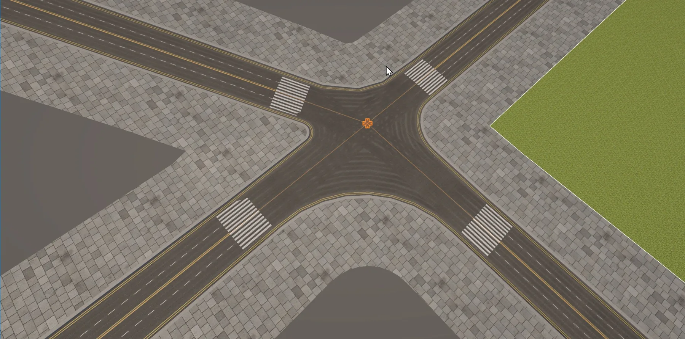
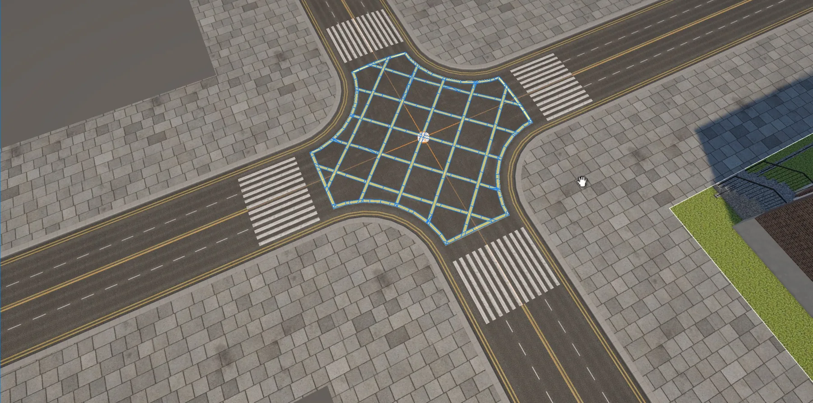

# Junctions

A **junction** is the mesh that joins roads where they meet. World Toolkit generates it from the roads' layers: lanes, borders and sidewalks continue into the junction, and the middle is filled with a core surface.

<figure markdown="span">
  { loading=lazy }
  <figcaption>A junction joining four roads that meet at uneven angles.</figcaption>
</figure>

## :lucide-git-merge: Creating junctions

Junctions are created when roads meet:

- Draw a road and click on another road or on a junction. See [Creating Roads](creating-roads.md#connecting-while-drawing).
- Drag a road's knot onto another road, or onto a junction.
- Select linked splines and use **Create from Selection** under **New Roads** in the Roads panel.

Behind the scenes, the roads' knots are linked with a :wtk-component-spline-link-group: [Link Group](../splines/link-groups.md), so moving the junction moves all connected road ends together.

New junctions start with the settings of the **New Roads** rules. See [Where junction settings come from](#where-junction-settings-come-from).

A new junction is named after the roads it joins, such as *Road Junction Main Street, Road (2)*. In the Hierarchy, it goes right after the last junction you created, under the same parent, so moving a junction into a group makes the next ones go there too. Until you have created one, it goes after the last new road.

## :wtk-component-editable-mesh-junction: Junction settings

**Junction Core Resolver**
:   How the core, the middle of the junction, is built: **Intersections** or **Delaunay Subdivs**. The [intersection settings](#intersection-settings) only affect **Intersections**.

**Continue Road Profile U Vs**
:   Continues the road surface textures from each road into the junction entrance, instead of restarting them. The center keeps a flat (planar) mapping. Borders are set per conversion, below.

**Fallback Junction Core Material**
:   The material for core faces that don't continue a road profile. Leave it empty to keep the current one.

**Junction Core UV Scale**
:   Texture scale of the core.

**Core Subdivision Size**
:   The size of the triangles inside the core. Smaller values add detail without changing the junction's outline.

**Lock Materials**
:   Keeps the current material slots when the junction rebuilds.

**Conversion Adjustments**, **Conversion Arc Mode** and **Shared Conversion Arc Radius**
:   The shape of the corners between roads. See [Conversions](#conversions).

**Marking**
:   A painted area over the middle of the junction, such as a box junction grid. See [Junction marking](#junction-marking).

**Mute**
:   Roads ignore this junction, as if it weren't there; it still rebuilds its own mesh. Muted junctions are outlined with a red box in the Scene view.

### Junction heights

The whole junction lies on one flat plane through the junction's position. The plane turns with the junction object: rotate the junction to tilt it, for example to follow a hillside. A junction turned almost on its side lies on a level plane instead. The core lies on the plane, and curbs and sidewalks sit on it at their own heights.

The roads bend to meet the plane, not the other way round. At each mouth the road's end moves up or down onto the plane and tilts to its slope across the road, so its lanes, curbs and crossings meet the junction exactly. From the mouth the road eases back to its own grade, over a length that grows with how far its end had to move, so the extra slope stays gentle. Only the road's mesh bends: its spline is unchanged.

When a road runs between two junctions on neighbouring knots, with no knot of its own between them, and both easings would overlap, the road doesn't go back to its own grade between the two mouths. It passes smoothly from one junction's plane to the other's, level with each junction at its mouth. Where the junctions sit at very different heights close together, that stretch can get steep: move the junctions apart, or tilt them, to soften it.

This keeps every junction flat and its curbs at their height, even where roads arrive at different heights, such as a ramp leaving a flat road at a sharp angle. Two roads that leave the junction side by side at different grades still drift apart in height past their mouths; the layout needs room there.

Junctions made with an earlier version are laid on the plane too when they rebuild, so their surface and their roads' ends can change shape.

### Conversions

A **conversion** is where the borders of two neighbouring roads meet inside a junction, for example the curb going around a corner.

**Conversion Arc Mode** sets how the radius of each corner is chosen:

| Mode | What it does |
|---|---|
| **Per Conversion** | Each conversion uses its own **Conversion Arc Radius**. |
| **Shared Radius** | Every conversion uses the junction's **Shared Conversion Arc Radius**. |
| **Aligned Mouths** | Every conversion starts from the **Shared Conversion Arc Radius**, then each corner is tuned so that both curb arcs of a road leave it at the same distance, keeping mouths square to their road on skewed junctions. A corner's radius stays between half and one and a half times the shared radius, so every corner keeps its apex; where squaring a mouth would need more, the mouth is left slightly skewed. |

With a shared mode, each conversion's own **Conversion Arc Radius** is greyed out. Junctions with only two mouths (two road ends meeting) always use their conversion's own radius.

Where a road curves before it reaches its corners, such as a ramp joining a road at a shallow angle, each corner is placed where the curbs of the two roads really meet. From the mouth up to the corner's arc, the curbs and sidewalks follow the road's own edges, so the junction keeps the shape of the ramp. A corner without an arc meets where each border crosses along the two roads; with a **Conversion Arc Radius** of 0 it stays sharp.

A junction with only two mouths that meet at an angle is one bend of the road. Its **Conversion Arc Radius** is the inner curb of the bend, and the outer curb is drawn around the same centre, so the road keeps its width all the way round and both curbs start their curve at the same point of each road.

When the two roads are almost in line, the junction is a transition between them instead. If both roads have the same profile, every lane, curb and sidewalk keeps its width through it: roads meeting at a slight angle bend round one smooth arc, as long as the shorter of the two mouths allows, and roads side by side shift across with an S curve. Lengthen the mouths with **Two Mouth Transition** to make the bend gentler.

Each conversion has an entry under **Conversion Adjustments**:

**Conversion Arc Radius** and **Conversion Arc Segments**
:   The radius and smoothness of the curve between the two roads' borders.

**Do Not Collapse To Border Intersection**
:   On tight corners, the outer border of a conversion can collapse to the point where the two roads' outer borders cross. Turn this on to keep it from collapsing there.

**Continue Border Profile U Vs**
:   Continues the border textures (curbs, sidewalks) of both roads through the conversion. When it's off, **Border Triplanar UV Rotation** rotates the border texture instead.

**Two Mouth Transition**
:   Only for junctions with exactly two mouths, for example where a road changes width or profile. With **Override Mouth Distances**, **First Mouth Distance** and **Second Mouth Distance** set how far from the junction point each road stops, and so how long the transition is. **Bias** moves the S-shaped transition toward the first road (0) or the second (1); a bend between roads with the same profile stays centred where the roads meet.

### Junction marking

**Marking** paints an area over the junction's road surface, between the curb arcs: a box junction grid, a colored area and so on. It's a :wtk-component-mesh-decal-area: [Mesh Decal Area](../modelling/decals.md) that the junction creates and keeps in shape.

**Enabled**
:   Turns the marking on. The junction adds a **Junction Marking** child object holding the decal, and removes it when you turn the marking off.

**Decal**
:   A [Mesh Decal Area Settings](../modelling/decals.md#settings-assets) asset with the marking's fill, outline and materials. It's shared by every junction and decal that uses it. Click **New** to create one, or expand the field to edit it from the junction.

**Inset**
:   Distance kept from the curbs and from each road's curb line.

**Trim At Kerb Lines**
:   Stops the marking at each road's curb line, where the curb arcs start, so it stays clear of crossings and lane markings. Turn it off to also cover the junction lead-ins.

Whenever the junction rebuilds, the decal's outline is redrawn to match it.

<figure markdown="span">
  { loading=lazy }
  <figcaption>A box junction marking, with the yellow curb lines following each corner.</figcaption>
</figure>

!!! tip "Same marking everywhere"
    Set **Junction Marking** in a [Road Rules](creating-roads.md#road-rules) asset to give it to new junctions, or to the junctions you select when you click **Apply to Selected**.

## :lucide-paintbrush: Markings in junctions

Road markings stop where the road surface is cut at the junction, unless they're set to continue:

- Sub layers and lane divisions with **Extend Into Junctions** continue over the junction lead-in, up to where the curb arcs start. See [Layers](profiles-and-layers.md#layers).
- A marking inside a border profile, like a no-parking line in a gutter, follows the border around the corner: straight lead-in, conversion arc and lead-out.
- **Marking** paints the middle of the junction, as above.
- With the **Lane Wear Lit** shader, the tire tracks follow the lane guides through the junction. See [Road materials](profiles-and-layers.md#road-materials).

## :lucide-file-box: Where junction settings come from

New junctions copy their starting settings from the **Junctions** section of the Road Rules set under **New Roads** in the Roads panel:

| Road Rules | Junction |
|---|---|
| **Junction Core Resolver**, **Continue Road Profile U Vs**, **Junction Core UV Scale**, **Core Subdivision Size**, **Fallback Junction Core Material** | The same settings. |
| **Lock Junction Materials** | **Lock Materials** |
| **Conversion Arc Mode** | **Conversion Arc Mode** |
| **Default Conversion Arc Radius** | **Shared Conversion Arc Radius**, and the **Conversion Arc Radius** of new conversions. |
| **Default Conversion Arc Segments** | The **Conversion Arc Segments** of new conversions. |
| **Junction Marking** | **Marking** |

After that, the settings belong to the junction, and editing the rules doesn't change existing junctions. To update them, select them and click **Apply to Selected**. See [Applying rules](creating-roads.md#applying-rules-to-existing-roads-and-junctions).

### Intersection settings

These two settings are shared by every junction that uses the **Intersections** core resolver. They're read from the **Junction Intersections** section of the **New Roads** rules: change them there, or pick other rules under **New Roads**, and those junctions rebuild.

**Intersection Adjacent Pair Angle**
:   How far, in degrees, two roads can be from pointing in exactly opposite directions and still be paired as neighbours.

**Intersection Vertex Merge Distance**
:   Merges interior vertices closer than this. Road mouths, arcs and their corners stay fixed. Zero turns it off.

## :lucide-file-down: Exporting junction information

Right-click a junction component and choose **Export Junction Information...** to save a text report of its connections and mesh. It's useful to attach to a [bug report](../support/reporting-issues.md) about a junction.
