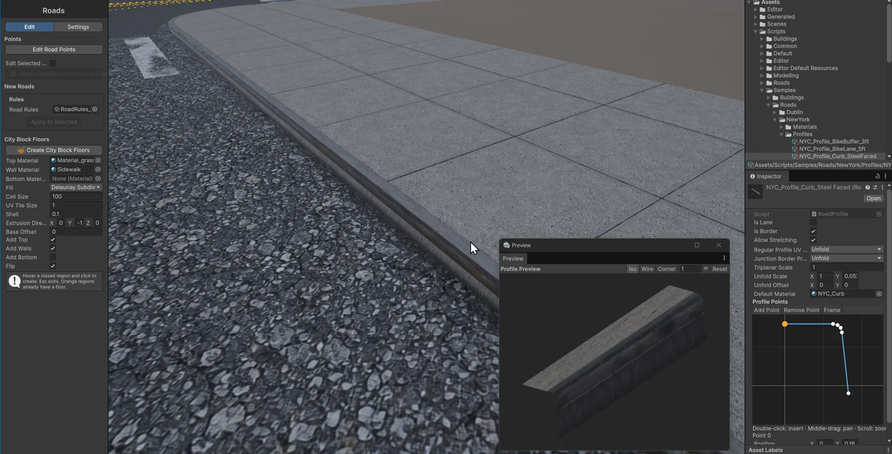

# Profiles and Layers

A road's cross-section is built from **layers**, placed side by side across the road. Each layer has a **profile** that gives it its shape.

For example, a simple street might have: sidewalk, curb, two lanes, curb, sidewalk.

## :lucide-pen-tool: Road Profiles

A **Road Profile** is an asset holding a 2D shape: the outline of a curb, a sidewalk or a lane surface. Create one from **Assets > Create > World Toolkit > Roads > Profile**, or click **New** next to a layer's **Profile** field to save a new one and assign it.

### Editing the shape

Select the profile asset to edit its points in the **Profile Points** graph:

- **Click** a point or span to select it, and **drag** points to move them. ++esc++ during a drag cancels the move.
- **Double-click** a span to insert a point. ++delete++ removes the selected point.
- **Middle-drag** pans, **scroll** zooms, ++f++ frames the shape.

**Add Point**, **Remove Point** and **Frame** do the same from buttons.

For the selected point:

**Position**
:   The exact coordinates.

**Shading**
:   **Hard** gives a sharp edge at this point instead of a smooth one.

For the selected span (the segment between two points):

**Span Material**
:   A material for this part only. Leave it empty to use the profile's **Default Material**.

The **Profile Preview** at the bottom of the inspector shows the result in 3D. **Corner** previews it around a corner, the number next to it is the preview length in meters, and **Iso**, **Wire** and **Reset** change the view.

<figure markdown="span">
  { loading=lazy }
  <figcaption>A steel-faced curb: its Profile Points, the Profile Preview and the result on the road.</figcaption>
</figure>

### Profile settings

Whether a layer is a lane or a border is set on the [layer](#layers) (**Is Lane**, **Is Border**), not on its profile, so one profile can serve both.

**Regular Profile UV Type** and **Junction Border Profile UV Type**
:   How textures are mapped: along roads, and for border layers inside junctions. **Unfold** follows the profile along the road, with **Unfold Scale** and **Unfold Offset**. **Triplanar** projects the texture in world space, with **Triplanar Scale**.

**Default Material**
:   The material used for spans with no material of their own.

## :lucide-columns-3: Layers

Layers are set on the road component, under **Road Layer Groups**, or in the **Groups** of a [Road Rules](creating-roads.md#road-rules) asset.

**Name** and **Profile**
:   The layer's name and its Road Profile.

**Is Lane**
:   Marks the layer as a traffic lane. Lanes have a direction and show lane guides, and the road's lanes (lane controls, [Lane Overrides](creating-roads.md#road-settings), junction lane connections) are its lane layers. The lane settings (**Lane Direction**, **Extra Lane Count** and **Lane Divisions**) only work on lane layers, and are greyed out on others. In a centred group, the lane layers sit around the road's spline and the layers beside them extend outwards (see [Layer Groups](#layer-groups)).

**Is Border**
:   Marks the layer as a road border (curb, gutter, sidewalk). Junctions treat borders differently from the road surface: borders continue around the [corners](junctions.md#conversions) between roads, with the profile's **Junction Border Profile UV Type**.

!!! note "Rules and roads from before v0.0.7"
    **Is Lane** and **Is Border** used to be set on the profile. Layers saved before take them from their profile when their rules or road are opened or edited, and keep them from then on.

**Alignment** and **Offset**
:   Where the layer sits: **Left**, **Center** or **Right**, then shifted by **Offset**.

**Muted**
:   The layer keeps its place across the road but builds nothing, its sub layers, lanes and dividers neither, on the road and in its junctions. Mute it on a road that follows [Road Rules](creating-roads.md#road-rules) from the Scene view (**Mute Layers...**, below): that mutes it on that road only.

**Mirror**
:   Flips the profile, to use the same curb asset on both sides of the road.

**Width Multiplier**
:   Scales the layer's width. A road that follows [Road Rules](creating-roads.md#road-rules) can give a layer its own width with [Layer Overrides](creating-roads.md#road-settings). With **Show Width Controls** on, drag or type it in the [Scene view](creating-roads.md#layer-widths-in-the-scene-view).

**Lateral Bulge**
:   A curve that raises the layer across its width, for a crowned road that sheds water. The X axis goes from 0 at the left edge to 1 at the right edge, and the Y axis is the extra height.

**Spline Ranges**
:   Limits the layer to parts of the road. Leave it empty to use the whole length. See [Spline ranges](#spline-ranges).

**Sub Layers**
:   Layers placed relative to this one and painted over it, such as a line on a lane or a no-parking line in a gutter.

**Extend Into Junctions**
:   Sub layers only. Continues the sub layer over the junction lead-in, up to where the curb arcs start, instead of stopping where the road surface is cut. Meant for markings painted on the road. A marking that sits inside a border profile, like a gutter line, follows the border around the junction corner. See [Markings in junctions](junctions.md#markings-in-junctions).

### Lanes

For lane layers (layers with **Is Lane** on; for other layers, these fields are greyed out in the inspector):

**Lane Direction**
:   **Forward**, **Backward** or **Both**.

**Extra Lane Count**
:   Adds more lanes of the same profile next to this one.

**Lane Divisions**
:   Dividers between lanes, each with its own **Profile**:

    - **Directions** sets which lanes they separate: **Any**, **Same Direction** or **Opposite Directions**.
    - **Placement** decides whether the divider opens a gap between lanes (**Open Gap**) or sits on the seam between them (**On Seam**).
    - **Width Multiplier**, **Mirror** and **Offset** size and place the divider.
    - **Conform To Surface** makes the divider follow the lane surface below it (its bulge and profile shape) instead of spanning it as a straight strip. **Offset** Y then lifts it above that surface.
    - **Extend Into Junctions** continues the divider over the junction lead-in, up to where the curb arcs start.
    - **Spline Ranges** limit the divider to parts of the road. Outside them, the divider and its gap are removed.

You can also edit lanes in the Scene view. Select a road to show its lane controls:

- **Click** a lane's arrow to switch its direction between **Forward**, **Backward** and **Both**. On an extra lane, the arrow flips that lane's direction.
- **Click** the **+** button to add an extra lane, or the **−** button on an extra lane to remove one.

!!! warning
    On a road that references [Road Rules](creating-roads.md#road-rules), these lane edits change the rules asset, and so every road that uses it. To change one road only, turn on that lane's **Lane Overrides** in the [road inspector](creating-roads.md#road-settings) first.

A single lane can be limited to parts of the road: turn on **Lane 1 Spline Ranges**, **Lane 2 Spline Ranges** and so on in the road's [Lane Overrides](creating-roads.md#road-settings), on a road with or without rules, or add a range to the lane in the [Scene view](#editing-spline-ranges-in-the-scene-view). Outside its ranges the lane isn't built, with its sub layers and the dividers beside it, and its place stays empty: the other lanes don't move. Rules don't have lane ranges; they belong to each road.

## :lucide-ruler: Spline ranges

Layers, sub layers, lane divisions, layer groups and single lanes (in a road's [Lane Overrides](creating-roads.md#road-settings)) can be limited to parts of the road with **Spline Ranges**. With an empty list they apply everywhere. Each range has an **Anchor**:

| Anchor | What it covers |
|---|---|
| **Spline** | One **Range** on the spline path chosen by **Spline Path Index**. |
| **Junction Mouths** | One interval at every junction mouth of every spline path, measured from the mouth's curb line back along the road: it starts **Mouth Setback** from that line and runs for **Mouth Length**. |

Enable **Flip** on a range to use everything **except** that part. Normal ranges add up, and flipped ranges each remove their part.

Use spline ranges for a sidewalk that only exists on one block, or a parking lane that stops before a corner.

A limited layer is built with the same rows as the rest of the road where it runs, plus a row at each of its ends laid on the edges of the layers beside it (they get no extra rows), so its edges meet theirs exactly, even on curves.

### Editing spline ranges in the Scene view

Turn on **Show Spline Range Controls** under **Points** in the [Roads panel](index.md#the-roads-panel) to show the spline ranges of the selected roads in the Scene view. Each range is drawn beside the road where what it limits lies: groups (blue) along their left edge, layers (orange), sub layers (violet) and lanes (yellow) along their middle, with a small cube at each end exactly where the range starts and ends. Ranges of different elements that would lie on top of each other over the same stretch move apart sideways. A flipped range is dotted. A **Junction Mouths** range shows one interval at each junction mouth.

- **Drag** the handle at either end of a range to move that end along the road. The end keeps its anchor (the path's start, end or a knot) and its distance type (units or percent); with a range set by a start and a distance, the other end stays where it is. On a **Junction Mouths** range, the end nearer the junction sets **Mouth Setback** and the other one **Mouth Length**. **Esc** while dragging puts the range back.
- **Click** an end to select it: it and its range light up, the other ranges fade, and the **Spline Range** overlay (bottom right of the Scene view by default) shows what the range belongs to (**Road**, **Group**, **Layer**, **Sublayer**, **Lane**) and which of its ranges it is (**Range**, with whether it's an override or the rules'), then its settings as in the inspector. **Anchor** measures the range from the spline path or from each junction mouth, keeping it where it is. **Type** picks **Start To End** or **Start Distance**. The next row edits this end: what it is measured from (**Start**, **End** or **Knot**, with the knot's index **K**), its distance (**+**) and whether that is in **Units** or **Percent** (a fraction of the path, 0-1); for the end of a **Start Distance** range, its **Distance**. Changing a type keeps the end where it is. A **Junction Mouths** range shows **Setback m** and **Length m**. Press **Enter** to apply a number. **Frame Selected** (++f++) frames the selected end; **Esc** deselects it.
- **Shift+click** ends to select several (of the same range or of others, on any of the selected roads), or to take one out of the selection. The overlay shows how many are selected and the settings of the last one clicked: what the ends don't share shows as a dash (**—**), and a setting changed there applies to every selected end that has it, in one undo step (a start and an end selected together share their measure row, labelled with both, as **Start/End**). **Frame Selected** frames them all. **Drag** one of the selected ends to move them all as far along the road (each along its own path; select both ends of a range to slide it whole); a click on one of them without dragging selects it alone.
- **Right-click** a range or one of its ends to **Flip** or **Remove** it, or to **Remove Override** (the element follows the rules' ranges again, on a road with rules; lanes' ranges are always the road's own). The **Anchor** field of the **Spline Range** overlay measures a range another way.
- **Right-click** the road and choose **Add Spline Range Here** to add a range to one or several elements at once. The **Add Spline Ranges** panel opens at the pointer with a range around that point: tick the groups, layers, sub layers and lanes under **Add To** (**All**, **None**), then set the range as in the **Spline Range** overlay (**Anchor**, **Type**, each end's measure, or a junction mouth's **Setback m** and **Length m**), **Flip** it, and turn on **Replace** to replace the ticked elements' ranges instead of adding to them. Meanwhile the new range shows along every ticked element, beside its own ranges; drag a preview's end to move that end for all of them, or right-click a preview to leave its element out. **Add** adds them in one undo step (on an element without ranges, which used the whole road, the element then only applies there) (on a road with rules, one question overrides every ticked element that follows them); **Cancel** or **Esc** closes the panel.
- **Right-click** the road and choose **Mute Layers...** to mute or unmute its groups and layers. The **Mute Layers** panel opens at the pointer with each group and layer ticked when muted (in red); what you are about to mute shows dashed in red along the road. **Apply** mutes and unmutes them in one undo step (on a road with rules, in that road's overrides only); **Cancel** or **Esc** closes it. Ranges of muted groups and layers (and of their sub layers and lanes) still show, dashed in red, and dragging one first asks to unmute it; a muted group or layer without ranges shows as a light red dashed line along the road. Right-click either to **Unmute** it. In the **Add Spline Ranges** panel, muted groups and layers are listed in red.

Hover a range to see what it belongs to and whether it's the road's own range, an override or the rules'.

!!! note "Roads that follow Road Rules"
    On a road that references [Road Rules](creating-roads.md#road-rules), these edits change the road's [Layer Overrides and Group Overrides](creating-roads.md#road-settings) (a lane's ranges, its Lane Overrides), never the rules asset. When the element's **Override Spline Ranges** is off, the first change asks whether to override it on this road: **Override** turns it on with copies of the rules' ranges, and **Cancel** leaves the ranges as they are.

!!! tip "Crossings and stop lines"
    Give a sub layer a **Junction Mouths** range to paint it at every junction the road reaches. Sub layers whose ranges are all unflipped **Junction Mouths** ranges are laid out straight along the lanes at the mouth, square to them, even where the road curves.

## :lucide-layers-2: Layer Groups

Layers are organized in groups: the road's **Road Layer Groups**, or the **Groups** of a Road Rules asset.

**Group Id**
:   The group's name, used by the settings below.

**Override Group Ids**
:   Groups this one replaces. Wherever this group is active, along its **Spline Ranges**, the groups listed here are turned off.

**Alignment On Anchor Group** and **Anchor Group Id**
:   **Center** puts the middle of the group's lane layers (from the first to the last, with whatever lies between them, like a median) on the road's spline, and the layers beside them extend outwards: a wider sidewalk on one side doesn't shift the lanes. A group without lane layers is centred as a whole. **Left Of Group** lines up the group's left edge with the left edge of the group named in **Anchor Group Id**, and **Right Of Group** lines up the right edges.

**Offset**
:   Shifts the whole group sideways (X) and up (Y).

**Ignore Junctions**
:   Leaves the group out of junction generation.

**Muted**
:   The group keeps its place across the road but none of its layers build anything. See the layers' **Muted**.

**Spline Ranges** and **Layers**
:   Where the group applies (see [Spline ranges](#spline-ranges)), and its layers.

## :lucide-square: Default mesh

When none of a road's layers has a profile, the road uses its **Default Mesh**: a strip with a **Material**, flat or shaped across its width by **Profile Curve**, with **Lateral Segments** across and a **Longitudinal Segment Length** along. With **Follow Spline Width**, its width comes from the spline's width data, falling back to **Width** where there's none.

**Position Jitter** and **Jitter Seed** add a small, repeatable random displacement, for a worn, uneven look. Road ends and junction mouths stay fixed.

On a road that references Road Rules, the default mesh comes from the rules.

## :lucide-paintbrush: Road materials

World Toolkit includes two shaders for road materials, for the Universal Render Pipeline. Pick them in a material's shader menu, under **WorldToolkit > Roads**.

**Lane Wear Lit**
:   Asphalt with procedural tire wear. **Albedo (Triplanar)**, **Normal Map (Triplanar)** and **Mask Map** are projected in world space (**Tiling Per Metre**, **Blend Sharpness**), so the texture lines up across roads and junctions. The **Wear** settings tint the wheel tracks with rubber (**Rubber Tint**, **Rubber Strength**, **Rubber Smoothness**) and oil (**Oil Tint**, **Oil Strength**), broken up by **Breakup Scale** and **Breakup Amount**. On roads, the tracks follow each lane (**Lane Tracks On Roads**; **Track Gauge**, **Track Width**, **Track Softness** and **Oil Width** are fractions of the lane width). In junctions, they follow the lane guides through the junction (**Lane Tracks In Junctions**), read from a small mask each junction bakes: **Junction Mask Detail** raises or lowers its resolution. When a junction's mesh is stored in the scene's [mesh folder](../modelling/settings.md#scene-meshes), its mask is stored with it instead of in the scene.

**Road Marking Lit**
:   Paint for markings: lane dividers, crossings and junction markings. Its **Depth Bias** (**Slope Factor** and **Units**) draws the paint over the asphalt without flickering, even where it's level with the road. **Alpha Clip** cuts out the parts below **Alpha Cutoff**.

Both take a **Mask Map** with metallic in R, occlusion in G and smoothness in A.
